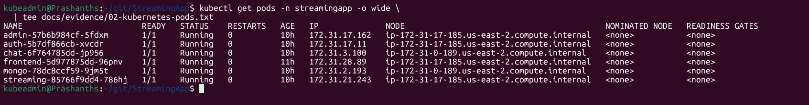
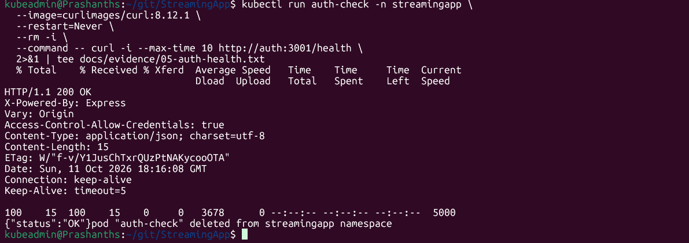
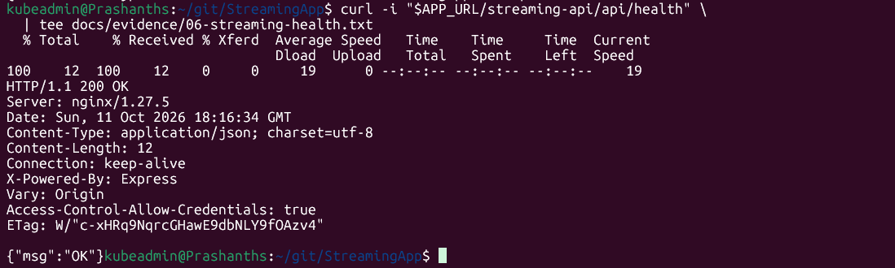
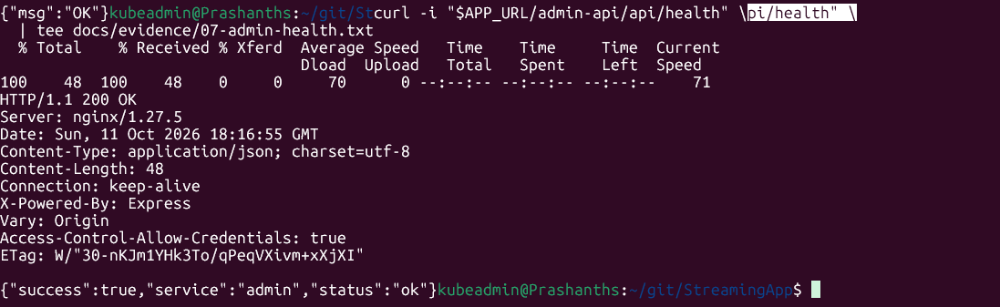
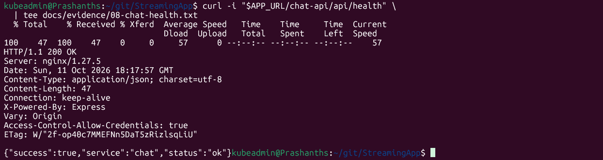

# StreamingApp --- MERN Application Deployment on AWS EKS

## 1. Project Overview

StreamingApp is a containerized MERN application deployed to Amazon
Elastic Kubernetes Service (Amazon EKS). It consists of a React
frontend, four Node.js/Express backend services, and MongoDB.

This README records the architecture, deployment approach, verification
commands, observed log evidence, troubleshooting, and cleanup steps from
the lab completed on 11 October 2026.

> **Evidence integrity:** Results below are based on commands and
> outputs captured during this deployment. Add your actual screenshots
> to `docs/evidence/` before submission. Do not fabricate evidence or
> commit credentials, JWT secrets, kubeconfig files, or populated
> Kubernetes Secret manifests.

## 2. Architecture

``` text
                         Browser
                            |
                         HTTP :80
                            |
                            v
                  AWS Load Balancer (ELB)
                            |
                   frontend LoadBalancer
                            |
                            v
                     React + Nginx
                     /      |      \
                    /       |       \
               /api/*   /streaming-*  /admin-api/*, /chat-api/*
                  |          |                |
                  v          v                v
              Auth :3001  Streaming :3002  Admin :3003 / Chat :3004
                  \          |                /
                   \_________|_______________/
                             |
                             v
                    MongoDB Service :27017
                             |
                             v
                  MongoDB Pod + 5Gi PVC
                    (EBS-backed storage)
```

### Kubernetes workloads

  ---------------------------------------------------------------------------
  Component    Kubernetes              Port Purpose
               service                      
  ------------ ------------- -------------- ---------------------------------
  Frontend     `frontend`                80 React static site served by
                                            Nginx; external LoadBalancer

  Auth         `auth`                  3001 Authentication and user APIs

  Streaming    `streaming`             3002 Streaming and video APIs

  Admin        `admin`                 3003 Administrative/video-management
                                            APIs

  Chat         `chat`                  3004 Chat API and Socket.IO

  MongoDB      `mongo`                27017 Application database with
                                            persistent storage
  ---------------------------------------------------------------------------

Backend services and MongoDB use internal Kubernetes `ClusterIP`
Services. The frontend is exposed through a Kubernetes `LoadBalancer`
Service.

## 3. Repository Layout

The repository includes the frontend and backend services, Dockerfiles,
and Docker Compose configuration. Kubernetes deployment files were
created under `k8s/`.

``` text
StreamingApp/
├── frontend/
│   ├── Dockerfile
│   ├── nginx.conf
│   └── src/
├── backend/
│   ├── authService/
│   ├── streamingService/
│   ├── adminService/
│   └── chatService/
├── docker-compose.yml
├── k8s/
│   └── streamingapp.yaml
└── README.md
```

Confirm the actual paths in the checked-out branch before submission.

## 4. Prerequisites

-   Git
-   Docker Engine or Docker Desktop with Compose support
-   AWS CLI configured for the intended AWS account
-   `kubectl`
-   `eksctl`
-   Access to Amazon ECR and Amazon EKS
-   Sufficient regional quota for EKS, EC2, load balancers, and EBS

The recorded lab used AWS account `706016980205`, region `us-east-2`,
and cluster `streamingapp-eks`. Consider whether to retain
account-specific infrastructure details if this repository is public.

## 5. Local Docker Compose Validation

The local Compose stack was started successfully. It contained MongoDB,
Auth, Streaming, Admin, Chat, and Frontend. MongoDB was intentionally
not published on host port `27017` because another unrelated container
already used that port; application containers reached MongoDB over the
Compose network.

``` bash
docker compose up -d --build
docker compose ps
```

Local endpoints:

  Component          URL
  ------------------ ------------------------------------
  Frontend           `http://localhost:3000`
  Auth health        `http://localhost:3001/health`
  Streaming health   `http://localhost:3002/api/health`
  Admin health       `http://localhost:3003/api/health`
  Chat health        `http://localhost:3004/api/health`

Previously captured local results: - `curl -I http://localhost:3000`
returned HTTP `200`. - `curl -i http://localhost:3001/health` returned
HTTP `200` and `{"status":"OK"}`. - Streaming, Admin, and Chat health
endpoints returned successful responses during local validation.

Stop the stack:

``` bash
docker compose down
```

Do not add `-v` unless you intentionally want to remove the Compose
database volume.

## 6. Frontend Routing and Containerization

The production frontend image uses a multi-stage Docker build: Node.js
Alpine builds the React application, then Nginx Alpine serves the static
build.

The Nginx configuration proxies: - `/api/` → Auth service -
`/streaming-api/` and `/streaming-public/` → Streaming service -
`/admin-api/` → Admin service - `/chat-api/` → Chat service -
`/socket.io/` → Chat Socket.IO endpoint

The frontend uses relative API paths so requests go through the same
external host rather than attempting to reach `localhost` from a user's
browser.

The frontend image was built and pushed to ECR:

``` text
706016980205.dkr.ecr.us-east-2.amazonaws.com/streamingapp-frontend:latest
```

Recorded image digest:

``` text
sha256:6c310a0bfbac86698820d59e3bfb5ff1ceaadfe47cd52697358e9d2dd4488982
```

For reproducible deployments, prefer immutable image tags or digests
over `latest`.

## 7. AWS EKS Deployment

### Cluster configuration used

  Setting                Value
  ---------------------- -----------------------------------
  Cluster                `streamingapp-eks`
  Region                 `us-east-2`
  Kubernetes version     `1.34`
  Worker node group      `streamingapp-workers`
  Worker instance type   `t3.small`
  Worker nodes           2
  MongoDB PVC            `mongo-data`, 5 GiB
  Frontend exposure      Kubernetes `LoadBalancer` Service

The initial `t3.medium` node-group attempt failed during setup. The
working managed node group was created with `t3.small` instances.

### Configure access

``` bash
aws sts get-caller-identity
aws eks update-kubeconfig --region us-east-2 --name streamingapp-eks
kubectl get nodes
```

### EBS CSI storage

The EBS CSI driver add-on and its IAM service account/role were
configured so the MongoDB PVC could bind to EBS-backed storage.

``` bash
kubectl get storageclass
kubectl get pvc -n streamingapp
kubectl describe pvc mongo-data -n streamingapp
```

### Apply the application manifest

The lab manifest was `k8s/streamingapp.yaml`.

``` bash
kubectl apply -f k8s/streamingapp.yaml
kubectl get deployments -n streamingapp
kubectl get pods -n streamingapp -o wide
kubectl get services -n streamingapp
```

**Security warning:** The working lab manifest included a Kubernetes
Secret containing the shared JWT secret. Do not commit it as-is to a
public Git repository. Replace secret literals with a secure
secret-management workflow and commit only a sanitized example manifest.

## 8. Deployment Verification and Log Evidence

### 8.1 Pod status

Captured command:

``` bash
kubectl get pods -n streamingapp -o wide
```

Observed status:

``` text
NAME                         READY   STATUS    RESTARTS
admin-57b6b984cf-5fdxm       1/1     Running   0
auth-5b7df866cb-xvcdr        1/1     Running   0
chat-6f764785dd-jp956        1/1     Running   0
frontend-5d977875dd-96pnv    1/1     Running   0
mongo-78dc8ccf59-9jm5t       1/1     Running   0
streaming-85766f9dd4-786hj   1/1     Running   0
```

### 8.2 Deployment readiness

Captured command:

``` bash
kubectl get deployments -n streamingapp
```

Observed output:

``` text
NAME        READY   UP-TO-DATE   AVAILABLE
admin       1/1     1            1
auth        1/1     1            1
chat        1/1     1            1
frontend    1/1     1            1
mongo       1/1     1            1
streaming   1/1     1            1
```

Pod names and addresses are historical evidence and may change when
workloads are recreated.

### 8.3 MongoDB ping

Command:

``` bash
kubectl exec deployment/mongo -n streamingapp -- \
  mongosh --quiet --eval "db.adminCommand('ping')"
```

Observed result:

``` json
{ "ok": 1 }
```

This confirms MongoDB was responding to commands at the time of the
test.

### 8.4 Auth health

Command run from a temporary in-cluster curl pod:

``` bash
kubectl run auth-check -n streamingapp \
  --image=curlimages/curl:8.12.1 \
  --restart=Never \
  --rm -i \
  --command -- curl -i --max-time 10 http://auth:3001/health
```

Observed response:

``` text
HTTP/1.1 200 OK
Content-Type: application/json; charset=utf-8

{"status":"OK"}
```

The temporary `auth-check` pod was automatically removed by
`kubectl run --rm`.

### 8.5 Streaming health

Command:

``` bash
curl -i "$APP_URL/streaming-api/api/health"
```

Observed response:

``` text
HTTP/1.1 200 OK
Content-Type: application/json; charset=utf-8

{"msg":"OK"}
```

Streaming logs included:

``` text
[streaming/db] Connecting to MongoDB at: mongodb://mongo:27017/streamingapp
Streaming service running on port 3002
[streaming/db] MongoDB connection established
GET /api/health 200
```

### 8.6 Admin health

Command:

``` bash
curl -i "$APP_URL/admin-api/api/health"
```

Observed response:

``` text
HTTP/1.1 200 OK
Content-Type: application/json; charset=utf-8

{"success":true,"service":"admin","status":"ok"}
```

### 8.7 Chat health

Command:

``` bash
curl -i "$APP_URL/chat-api/api/health"
```

Observed response:

``` text
HTTP/1.1 200 OK
Content-Type: application/json; charset=utf-8

{"success":true,"service":"chat","status":"ok"}
```

### 8.8 Finding the AWS load-balancer URL

The frontend Kubernetes Service was exposed as type `LoadBalancer`. The
captured command was:

``` bash
kubectl get svc frontend -n streamingapp
```

Captured output from this deployment:

``` text
NAME       TYPE           CLUSTER-IP       EXTERNAL-IP                                                              PORT(S)       AGE
frontend   LoadBalancer   10.100.207.99    acf266959194546a6ad3f8d3cefd822f-800507674.us-east-2.elb.amazonaws.com   80:31873/TCP  11h
```

The hostname can change if the Service or cluster is recreated. Retrieve
the current hostname dynamically:

``` bash
export APP_URL="http://$(kubectl get svc frontend -n streamingapp \
  -o jsonpath='{.status.loadBalancer.ingress[0].hostname}')"

echo "$APP_URL"
```

Example output from the recorded deployment:

``` text
http://acf266959194546a6ad3f8d3cefd822f-800507674.us-east-2.elb.amazonaws.com
```

Then test the frontend:

``` bash
test -n "$APP_URL" && echo "Application URL: $APP_URL"
curl -I "$APP_URL/"
```

### 8.9 Frontend UI access and screenshot evidence

The StreamFlix landing page was opened successfully in a browser using
the external load-balancer URL. The browser screenshot showed the
StreamFlix landing page UI.

Add the **actual screenshot captured during the assignment** to the
repository at:

``` text
docs/evidence/01-frontend-browser.png
```

Once the screenshot has been added, GitHub can display it using:

``` markdown

```

Capture and save the screenshot: 1. Open the URL printed by
`echo "$APP_URL"` in your browser. 2. Confirm the StreamFlix landing
page is visible. 3. Capture the browser window, including the address
bar to show the public URL. 4. Save it as
`docs/evidence/01-frontend-browser.png`. 5. Ensure no credentials,
tokens, or private information are visible.

Only add the Markdown image reference after the real screenshot has been
placed at that path; do not use a placeholder or claim the image is
already in the repository.

Recorded frontend HTTP response:

``` text
HTTP/1.1 200 OK
Server: nginx/1.27.5
Content-Type: text/html
```

### 8.10 Known Auth route mismatch

This public request returned `404`:

``` bash
curl -i "$APP_URL/api/health"
```

The Auth application exposes `/health`, while the Nginx `/api/` location
forwards `/api/health` to Auth as `/api/health`. The in-cluster request
to `http://auth:3001/health` returned HTTP `200`, so this was a path
mismatch rather than an unhealthy Auth pod.

If a public Auth health URL is required, add a dedicated Nginx route
such as `/auth-health` → `http://auth:3001/health` in
`frontend/nginx.conf`, rebuild and push the frontend image, and roll out
the new frontend image.

### Verification summary

  Check                                Result
  ------------------------------------ ------------------------------------
  Frontend pod                         `1/1 Running`
  Auth pod                             `1/1 Running`
  Streaming pod                        `1/1 Running`
  Admin pod                            `1/1 Running`
  Chat pod                             `1/1 Running`
  MongoDB pod                          `1/1 Running`
  MongoDB ping                         `{ "ok": 1 }`
  Frontend via load balancer           HTTP `200`
  Auth in-cluster health               HTTP `200`
  Streaming health via load balancer   HTTP `200`
  Admin health via load balancer       HTTP `200`
  Chat health via load balancer        HTTP `200`
  Public `/api/health`                 HTTP `404` --- known path mismatch

Health checks demonstrate that the tested endpoints responded; they do
not prove full end-to-end registration, login, video playback, chat
messaging, or administrative upload workflows. S3-backed uploads may
require bucket configuration and IAM permissions.

## 9. Troubleshooting

### MongoDB PVC remained Pending

**Cause:** EBS CSI provisioning was not initially functioning.

**Resolution:** Associated the EKS OIDC provider, configured an IAM
service account/role for the EBS CSI controller, enabled the add-on, and
waited for the MongoDB PVC to bind.

### MongoDB `DBPathInUse`

**Cause:** A rolling Deployment update briefly started two MongoDB pods
against the same ReadWriteOnce data volume.

**Resolution:** Changed the MongoDB Deployment strategy to `Recreate`
and removed the malformed startup probe. The replacement pod became
`1/1 Running`, and the MongoDB ping returned `{ "ok": 1 }`.

### Auth public health URL returned 404

**Cause:** The Auth app exposes `/health`, but Nginx forwards
`/api/health` unchanged.

**Resolution for verification:** Tested `http://auth:3001/health` from
inside the cluster; it returned HTTP `200`. A dedicated public health
route can be added if needed.

### Frontend image build

The production frontend image built successfully. React build warnings
appeared, but the build completed and the page loaded through the load
balancer.

## 10. Deployment Evidence and Screenshots

The screenshots below were captured during the deployment verification
and are stored in `docs/evidence/`. They document the frontend UI,
Kubernetes workload status, database connectivity, and API health
checks.

### 10.1 Frontend UI through the AWS load balancer

File: `docs/evidence/01-frontend-browser.png`


The screenshot records browser access to the StreamFlix landing page
through the public load-balancer URL. The frontend also returned HTTP
`200 OK` when checked with `curl -I "$APP_URL/"`.

### 10.2 Kubernetes pods

File: `docs/evidence/02-kubernetes-pods.png`



This screenshot records the status of the six application pods:
frontend, auth, streaming, admin, chat, and MongoDB.

### 10.3 Kubernetes deployments

File: `docs/evidence/03-kubernetes-deployments.png`


This screenshot records deployment readiness, with all six deployments
showing `1/1` available at the time of verification.

### 10.4 MongoDB connectivity

File: `docs/evidence/04-mongodb-ping.png`


The MongoDB ping command returned `{ "ok": 1 }`, confirming that MongoDB
responded to the database ping at the time of the test.

### 10.5 Auth service health

File: `docs/evidence/05-auth-health.png`



The in-cluster request to `http://auth:3001/health` returned HTTP
`200 OK` with `{"status":"OK"}`.

### 10.6 Streaming service health

File: `docs/evidence/06-streaming-health.png`



The public route `/streaming-api/api/health` returned HTTP `200 OK` with
`{"msg":"OK"}`.

### 10.7 Admin service health

File: `docs/evidence/07-admin-health.png`



The public route `/admin-api/api/health` returned HTTP `200 OK` with
`{"success":true,"service":"admin","status":"ok"}`.

### 10.8 Chat service health

File: `docs/evidence/08-chat-health.png`



The public route `/chat-api/api/health` returned HTTP `200 OK` with
`{"success":true,"service":"chat","status":"ok"}`.

### Evidence limitations

These screenshots show the recorded state at the time of testing;
Kubernetes pod names and external hostnames may change if resources are
recreated. Health checks establish availability of the tested endpoints,
but do not independently demonstrate complete registration/login, video
playback, chat messaging, or video upload workflows.

The public Auth path `/api/health` returned `404` because the current
Nginx `/api/` mapping forwards that path unchanged, while the Auth
service's health endpoint is `/health`. The Auth endpoint was separately
verified from inside the cluster and returned HTTP `200`.

Before committing, ensure all eight image files are present at the paths
above and that screenshots do not expose credentials, secret values,
tokens, or private keys.

## 11. AWS Cleanup

After capturing assignment evidence and confirming a live deployment is
no longer needed for grading or demonstration, delete the EKS cluster to
avoid ongoing charges:

``` bash
eksctl delete cluster \
  --name streamingapp-eks \
  --region us-east-2 \
  --wait
```

**This is destructive.** Run it only when you no longer need the live
environment. Afterwards, verify that the cluster-created load balancer,
worker EC2 instances, and EBS volumes have been removed. If anything
remains, inspect ownership and remove only resources created for this
lab. Preserve ECR images/repositories and the GitHub repository.

Verification commands:

``` bash
aws eks describe-cluster \
  --name streamingapp-eks \
  --region us-east-2

aws ec2 describe-instances \
  --region us-east-2 \
  --filters Name=tag:eks:cluster-name,Values=streamingapp-eks \
  --query 'Reservations[].Instances[].[InstanceId,State.Name,InstanceType]'

aws ec2 describe-volumes \
  --region us-east-2 \
  --query 'Volumes[].[VolumeId,State,Size,AvailabilityZone,Tags]'
```

After successful deletion, the first command should report that the
cluster does not exist. Review EC2 and EBS results carefully because the
account may contain unrelated resources.

## 12. Security and Production Considerations

-   Never commit AWS access keys, JWT secrets, kubeconfig files, or
    populated Kubernetes Secret manifests.
-   Prefer IAM roles and short-lived credentials over long-lived access
    keys.
-   Use HTTPS/TLS for public access; the lab endpoint used HTTP.
-   Apply least-privilege IAM permissions for ECR, EKS, EBS, and S3.
-   Store production secrets in a dedicated secret-management system.
-   Pin image tags or digests for repeatable deployments.
-   Configure resource requests/limits, probes, monitoring, and alerts
    appropriate for the workload.
-   Use multiple replicas and resilient database architecture for
    production; this lab used one replica per application component and
    a single MongoDB pod.
-   Restrict public cluster endpoint access to trusted IP ranges and
    review security groups.
-   Review S3 bucket policy, CORS, and presigned URL configuration
    before enabling video uploads.

## 13. Conclusion

StreamingApp's frontend and four backend services were deployed to
Amazon EKS with MongoDB persistent storage. During recorded
verification, all six pods were `1/1 Running`; MongoDB responded to a
ping; the frontend loaded through the AWS load balancer; and Auth
(in-cluster), Streaming, Admin, and Chat health checks returned HTTP
`200`.

The public `/api/health` route remains a documented Nginx path mismatch,
while Auth's actual `/health` endpoint was confirmed healthy. Full
application workflows should be tested separately if required by the
assignment rubric.
